# GMI Prospect

An Android app that helps SPM leavers explore the courses at the **German-Malaysian Institute (GMI)**: browse
programmes, check eligibility from their SPM grades, take a short interest quiz, see their eligible courses ranked,
and apply through an admission form.

Built for **SPG 0562 Android Programming, PBL Assignment 2**. The main learning goal is the **Android Activity
lifecycle**, so every screen is designed to make lifecycle behaviour visible in Logcat and correct when the app is
rotated, backgrounded or switched between themes and languages.

> Student project. Not an official GMI app. Course information was taken from gmi.edu.my in October 2026 and may
> change.

## Screenshots

| Splash | Home | Courses | Course detail |
|:---:|:---:|:---:|:---:|
| 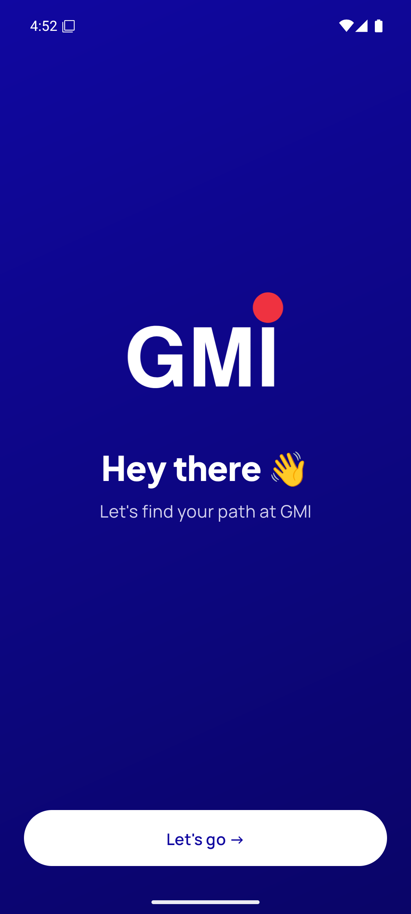 | 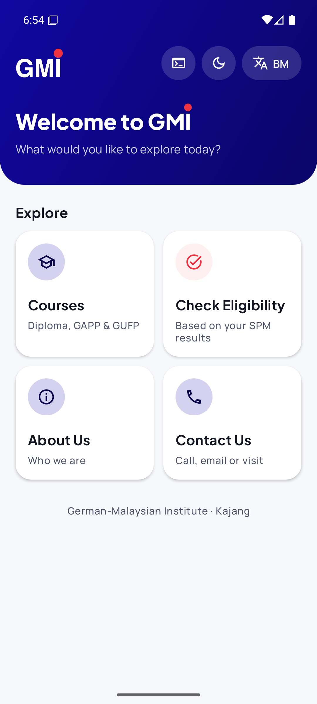 | 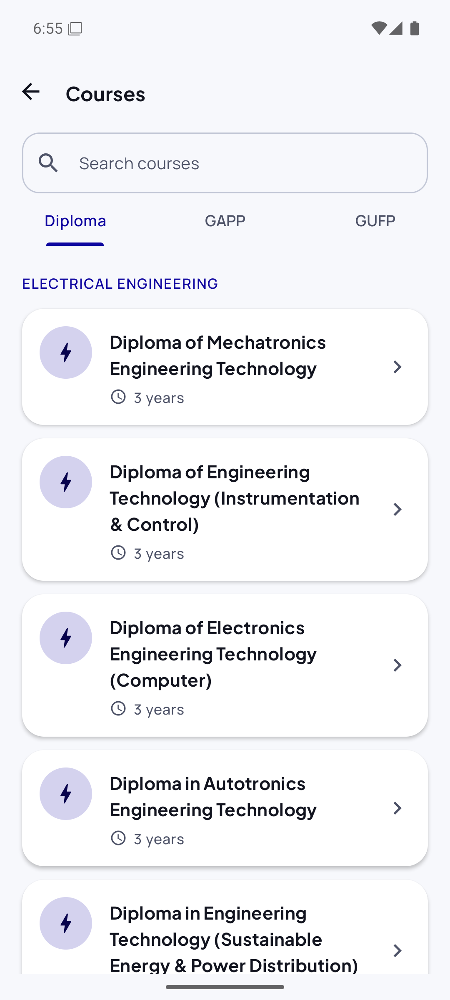 | 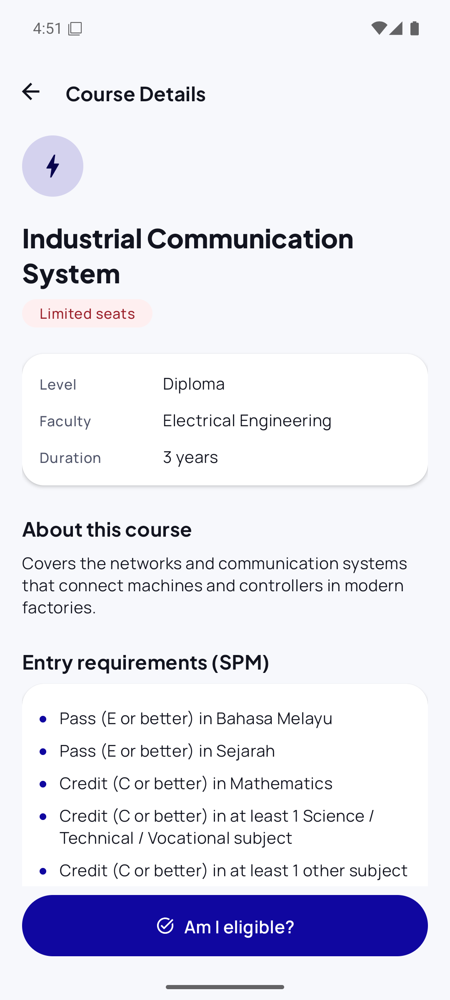 |

| Grade input | Interest quiz | Results | Admission form |
|:---:|:---:|:---:|:---:|
| 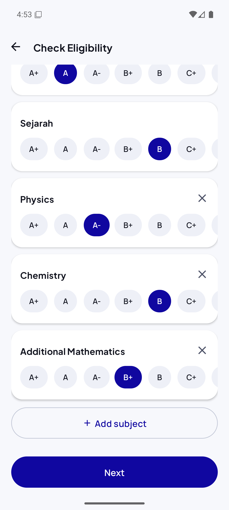 | 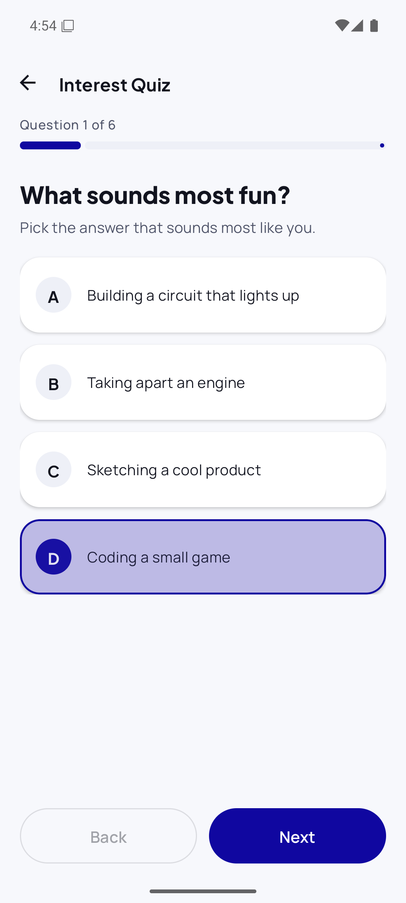 | 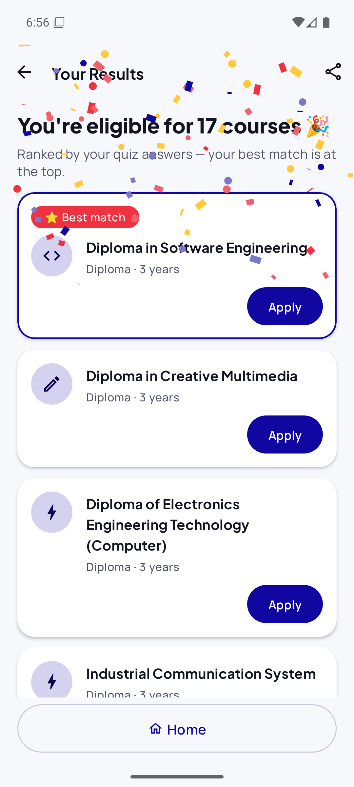 | 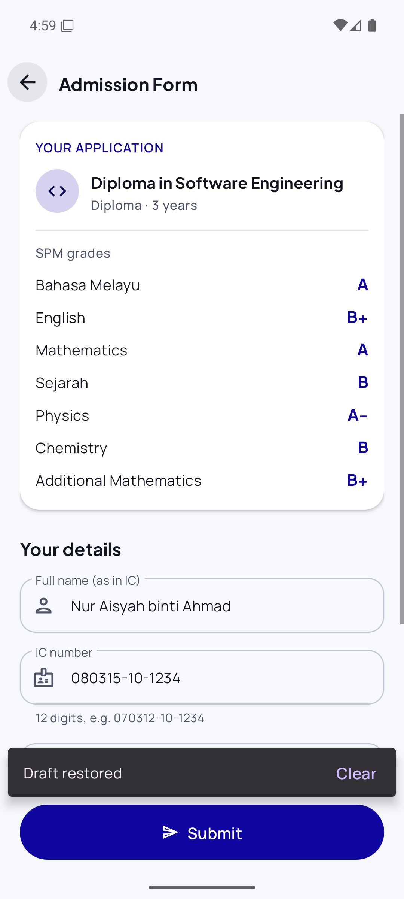 |

**Dark mode + Bahasa Melayu**

| Home | Not eligible | About Us | Contact Us |
|:---:|:---:|:---:|:---:|
| 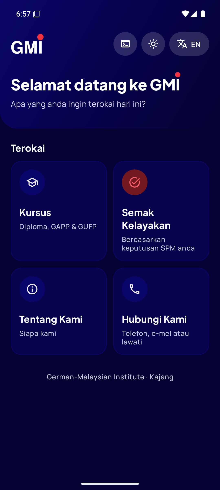 | 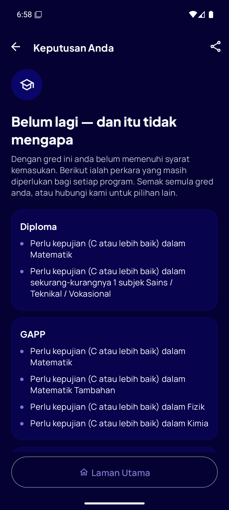 | 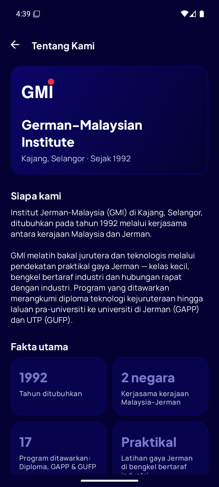 | 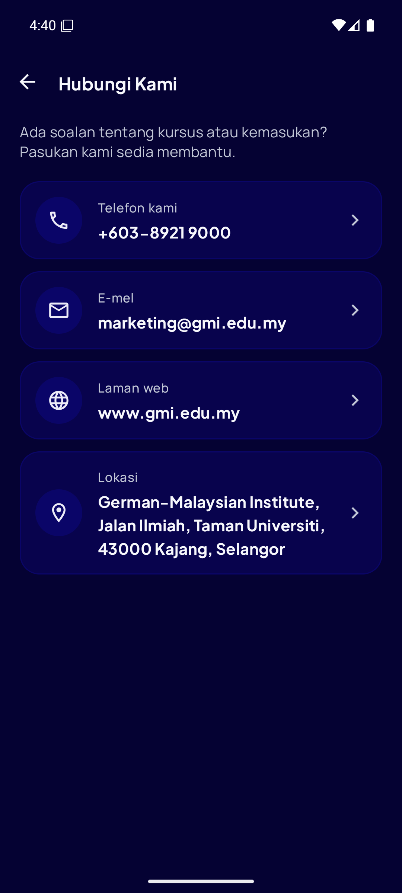 |

**Search, share and landscape quiz**

| Course search | Share results | Quiz in landscape |
|:---:|:---:|:---:|
| 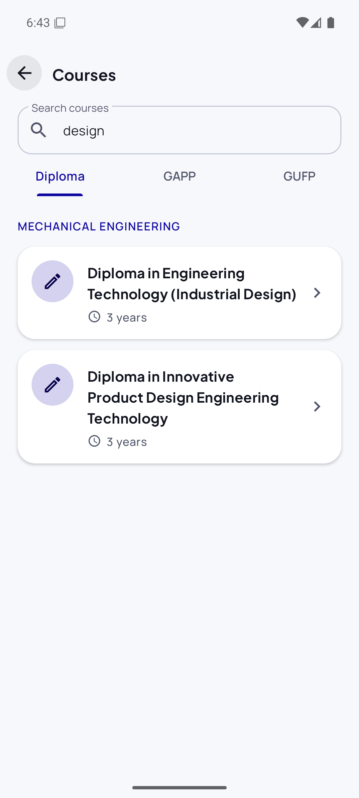 | 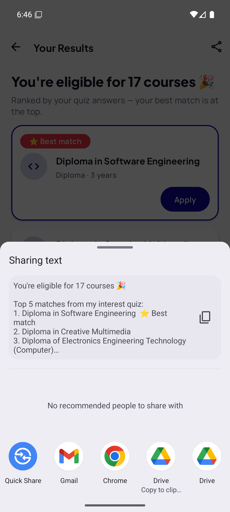 | 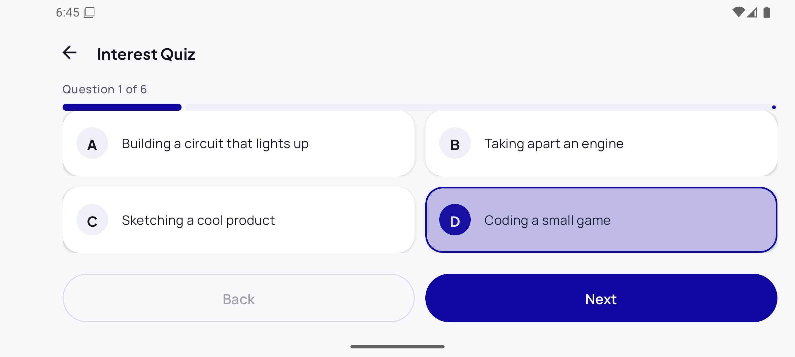 |

## Features

- **Courses**: 17 programmes (15 diplomas, GAPP, GUFP) in tabs, with diplomas grouped by faculty, and a search box
  that filters by course name.
- **Eligibility check**: enter SPM grades for the core subjects and any optional subjects. The app checks every
  programme's entry rules and explains what is missing for each level.
- **Interest quiz**: 6 questions score Electrical, Mechanical, Design and IT (with a 2×2 answer layout in landscape). The scores only change the order of
  the results, never eligibility.
- **Ranked results**: confetti when eligible, with a "⭐ Best match" badge on the top course. **Share** sends the top
  5 courses (or what's still missing) to any app.
- **Admission form**: validated fields (IC auto-formatted as `000000-00-0000`). The draft survives leaving the
  screen, and Submit opens the email app with everything filled in.
- **About Us / Contact Us**: call, email, website and map, opened through implicit Intents.
- **Light / dark mode** and **English / Bahasa Melayu**, switchable from Home and remembered between launches.
- **Lifecycle log**: an optional on-screen panel (the `>_` button on Home) that shows every lifecycle callback as it
  happens, so you can demo the lifecycle without Android Studio.

## The Activity lifecycle in this app

Every Activity extends [`BaseActivity`](app/src/main/java/com/gmi/prospect/base/BaseActivity.java), which logs all
eight lifecycle callbacks. In Android Studio's Logcat, filter by `tag:LIFECYCLE` to watch them:

```
HomeActivity → onPause
HomeActivity → onStop
HomeActivity → onSaveInstanceState
HomeActivity → onDestroy
HomeActivity → onCreate
HomeActivity → onStart
HomeActivity → onResume
```

**On-screen lifecycle log.** Tap the `>_` button on Home to dock a log panel under every screen. It shows the same
lines as Logcat, with timestamps, and the newest line flashes red. Collapse it to one line or clear it before each
demo step. It's off by default, the choice is remembered, and it only updates while its screen is visible
(`onStart` / `onStop`).

| Leaving and returning during the splash | Switching to dark mode on Home |
|:---:|:---:|
| 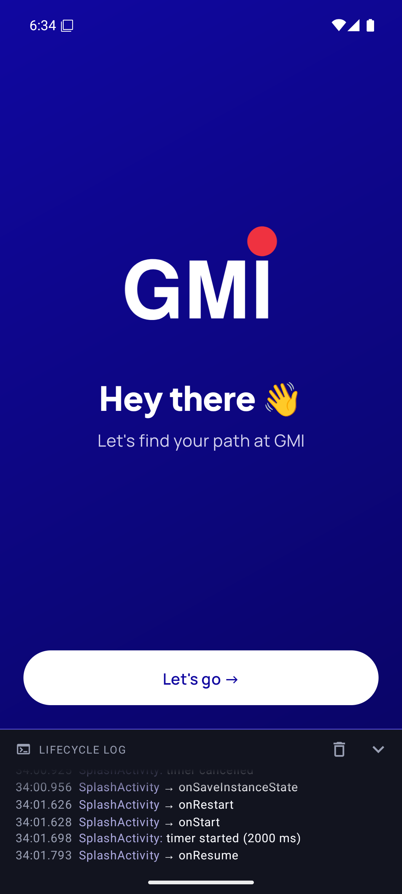 | 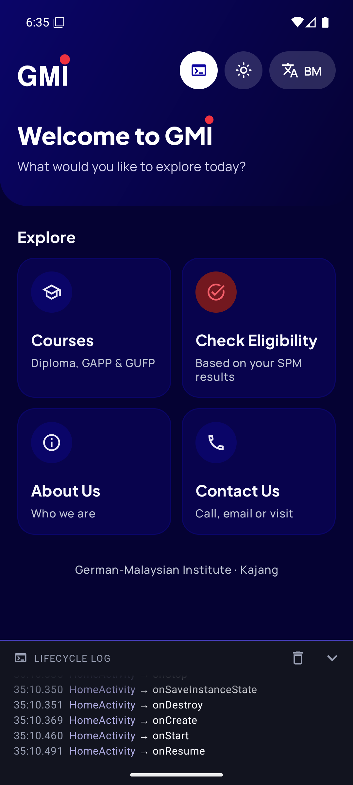 |

| # | Requirement | Where |
|---|---|---|
| 1 | Log every lifecycle callback | `BaseActivity`: all 8 callbacks, tag `LIFECYCLE` |
| 2 | State survives rotation, dark mode and language changes | `GradeInputActivity` (grades and added subjects) and `QuizActivity` (question and answers) via `onSaveInstanceState`. `CourseListActivity` keeps its tab the same way. |
| 3 | Form draft | `AdmissionFormActivity`: saved to SharedPreferences in `onPause`, restored in `onResume` with a "Draft restored" Snackbar, cleared after Submit |
| 4 | Splash timer that never fires in the background | `SplashActivity`: `Handler` + `Runnable` posted in `onStart`, removed in `onStop`, `finish()` after opening Home |
| 5 | No animation work in the background | `ResultActivity`: the custom `ConfettiView` starts in `onResume` and stops in `onPause` |
| 6 | Explain each lifecycle override | Every override has a comment saying why the work happens there |

## Tech stack

- **Java** with **XML layouts** (no Kotlin, no Compose)
- One screen = one **Activity**, navigation with explicit `Intent`s and extras (no Fragments)
- **Material Components 3**, RecyclerView, ConstraintLayout, MaterialCardView, chips
- No backend and no internet: all data is hard-coded in Java repositories
- Custom Canvas `ConfettiView` (no animation library)
- Fonts: Plus Jakarta Sans (headings) and Manrope (body), both under the SIL Open Font License
- minSdk 24, compile/target SDK 36

## Project structure

```
app/src/main/java/com/gmi/prospect
├─ GmiApp.java              Application class: applies the saved light/dark mode
├─ base/BaseActivity.java   Lifecycle logging, the log panel under every screen, shared helpers
├─ base/LifecycleLog.java   The log itself: Logcat + an in-memory list for the on-screen panel
├─ ui/                      The 10 Activities (Splash, Home, CourseList, CourseDetail, GradeInput,
│                           Quiz, Result, AdmissionForm, About, Contact)
├─ ui/adapter/              CourseAdapter, ResultAdapter
├─ ui/view/                 ConfettiView, SwitchOverlayView (theme/language switch animation),
│                           LifecycleLogView (the on-screen log panel)
├─ data/                    Course, Subject, Grade, enums, Course/Subject/Quiz repositories
└─ logic/                   EligibilityChecker, EligibilityResult, CourseRanker
```

Strings are in `res/values/strings.xml` (English) and `res/values-ms/strings.xml` (Bahasa Melayu).

## Eligibility rules

SPM grades `A+ A A- B+ B C+ C D E G`. Credit = C or better, pass = E or better. Every level needs a pass in
Bahasa Melayu and Sejarah.

| Level | Also requires |
|---|---|
| Diploma (all 15) | Credit in Mathematics, credit in 1 science/technical/vocational subject, credit in 1 other subject, pass in English |
| GAPP | Credit in English, Mathematics, Additional Mathematics, Physics and Chemistry |
| GUFP | Minimum C in Bahasa Melayu, Mathematics, English, Additional Mathematics, Physics and Chemistry |

Diplomas also need a colour-blindness and medical check. The app shows this as a note but cannot check it.

## Build and run

1. Open the project in **Android Studio** and let Gradle sync.
2. Run the `app` configuration on an emulator or phone (Android 7.0 / API 24 or newer).

From the command line on Windows:

```
gradlew.bat assembleDebug    # build the debug APK (app/build/outputs/apk/debug/)
gradlew.bat test             # run the unit tests (eligibility rules and ranking)
```

The Gradle daemon needs JDK 21. Android Studio's bundled JDK works: point `JAVA_HOME` at
`C:\Program Files\Android\Android Studio\jbr`. If Gradle still can't find a JDK 21 (it tries to download one), add
`"-Dorg.gradle.java.installations.paths=C:\Program Files\Android\Android Studio\jbr"` to the command.

## Try the lifecycle yourself

- **Rotate** on Grade Input or the Quiz: everything you picked is still there.
- **Press Home** during the splash: the app stays in the background instead of jumping to Home.
- **Press Home** while confetti is falling: it pauses, and continues when you come back.
- **Tap Share** on the Result screen: the share sheet only partly covers the screen, so you get `onPause` but no
  `onStop`, and the confetti freezes.
- **Type in the course search, then rotate**: the text comes back by itself (the field has an ID), while the
  selected tab needs `onSaveInstanceState`.
- **Leave the Admission Form** half filled in and open it again: "Draft restored".
- **Switch theme or language** on Home and watch Logcat as the Activity is destroyed and re-created.
- Or turn on the **`>_` lifecycle log** on Home and watch all of the above on the phone itself.
